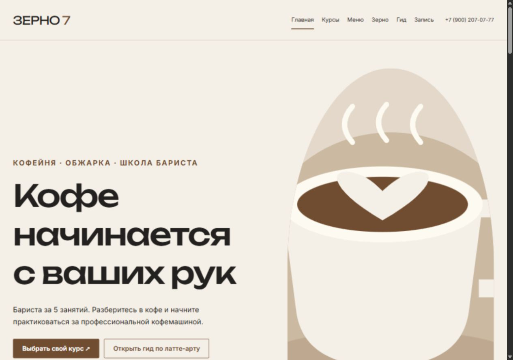
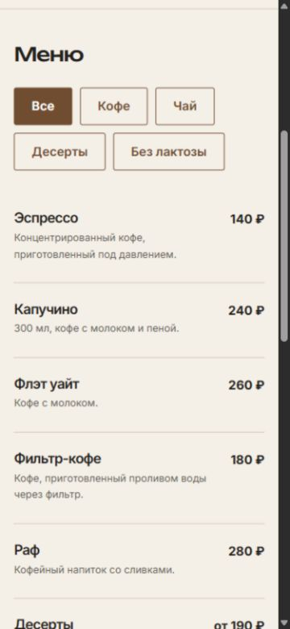

# funnel-project

Учебный репозиторий по ОП.03 «Информационные технологии». Здесь собраны задания, бланки ответов, лекции и материалы для практики. За семь работ вы проследите путь пользователя от перехода на сайт до заявки и научитесь проверять, какие данные сохранились на каждом этапе.

**[Домашние работы](#домашние-работы)** · **[Как сдать работу](#как-сдать-работу)** · **[Лекции и практика](#лекции-и-практика)** · **[Курсовая](#курсовая)**

## Как устроен практикум

*Рис. 1. Главная страница сайта «Зерно 7» из курсовой работы, вид на компьютере.*

1. Откройте свой репозиторий в VS Code через **Source Control → Clone Repository**. См. [инструкцию](docs/git/README.md#2-первый-репозиторий).
2. В таблице ниже выберите нужную работу. Условия и критерии лежат в её `README.md`, ответы вписываются в `homework_NN.md`.
3. Для работ 02–05 и 07 подготовьте отдельный сайт по шаблону [ga4-analytics-lab](https://github.com/MaximBytecamp/ga4-analytics-lab) и опубликуйте его на Vercel. Бланки и скриншоты сдавайте здесь.

## Домашние работы

Скриншоты из учебного сайта [ga4-analytics-lab](https://github.com/4youmans/ga4-analytics-lab) собраны в папках заданий: [ДЗ 2](lesson_02/screens/README.md), [ДЗ 3](lesson_03/screens/README.md), [ДЗ 4](lesson_04/screens/README.md), [ДЗ 5](lesson_05/screens/README.md), [ДЗ 6](lesson_06/screens/README.md), [ДЗ 7](lesson_07/screens/README.md).

| Работа | Что вы сделаете | Бланк |
|:--|:--|:--|
| [01 · Путь пользователя](lesson_01/README.md) | Выделите три события и найдёте точку потери данных. | [Заполнить](lesson_01/homework_01.md) |
| [02 · Воронка и GA4](lesson_02/README.md) | Разберёте этапы воронки и настроите ресурс GA4. | [Заполнить](lesson_02/homework_02.md) |
| [03 · Тег и источники](lesson_03/README.md) | Проверите тег, источник перехода и отчёты. | [Заполнить](lesson_03/homework_03.md) |
| [04 · Свои события](lesson_04/README.md) | Настроите четыре события и проверите их параметры. | [Заполнить](lesson_04/homework_04.md) |
| [05 · Сбор заявок](lesson_05/README.md) | Свяжете форму сайта с Google Таблицами через Apps Script. | [Заполнить](lesson_05/homework_05.md) |
| [06 · Очистка данных](lesson_06/README.md) | Обработаете выгрузку формулами и сохраните чистый CSV. | [Заполнить](lesson_06/homework_06.md) |
| [07 · ManyChat](lesson_07/README.md) | Проверите путь из Instagram через ManyChat и сайт до заявки. | [Заполнить](lesson_07/homework_07.md) |

## Как сдать работу

- Заполните шапку и все обязательные поля бланка. Добавьте собственные скриншоты в `screens/` и проверьте ссылки на них.
- Укажите полные адреса источников. Если использовали ИИ, запишите в бланке, для чего он понадобился. Факты и цифры сверяйте с первоисточниками.
- Проверьте, что в коммит не попали ключи, токены или личные данные из тестовых заявок.
- Сделайте коммит в `main` и нажмите **Sync Changes** в VS Code.

Количество кадров и сроки указаны в [порядке сдачи](docs/SUBMIT.md). Требования к бланку собраны в [общем шаблоне](HOMEWORK_TEMPLATE.md).

## Лекции и практика

| Раздел | Содержимое |
|:--|:--|
| [Лекции](lectures/README.md) | Конспекты по воронкам, UTM, GA4, заявкам, ManyChat и отчётам. |
| [Материалы занятий](materials/README.md) | Стенды, примеры кода, CSV, шаблоны отчётов и чек-листы. |
| [Git и VS Code](docs/git/README.md) | Инструкции для коммитов, синхронизации и веток. |

## Курсовая

*Рис. 2. Мобильный тест для подбора курса бариста на сайте «Зерно 7».*

Материалы собраны в [папке курсовой](kursovaya_rabota/README.md). [Бланк сдачи](kursovaya_rabota/kursovaya.md) лежит там же.

---

Учебные материалы и бланки взяты из [dothefuture/funnel-project](https://github.com/dothefuture/funnel-project). Скриншоты на главной взяты из курсовой «Зерно 7».
