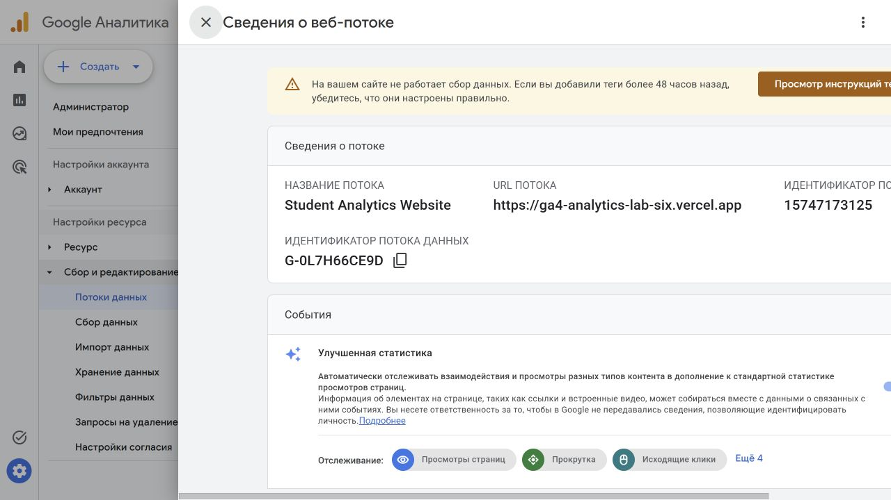

# Скриншоты задания 2

Формат PNG. Имена файлов:

| Файл | Что на кадре |
|---|---|
| `01-analytics-account.png` | создание Analytics Account, видно название |
| `02-property.png` | ресурс: часовой пояс и валюта |
| `03-business-goals.png` | выбор бизнес-целей |
| `04-web-stream.png` | веб-поток: Website URL, Stream name, Enhanced Measurement |
| `05-measurement-id.png` | Web stream details, виден Measurement ID `G-XXXXXXXXXX` |

Measurement ID не замазывать: по нему проверяется, что ресурс ваш.

Этот файл удалять не нужно.

## Кадры из своего проекта

Источник — [4youmans/ga4-analytics-lab](https://github.com/4youmans/ga4-analytics-lab).

*Веб-поток учебного сайта и его Measurement ID.*
