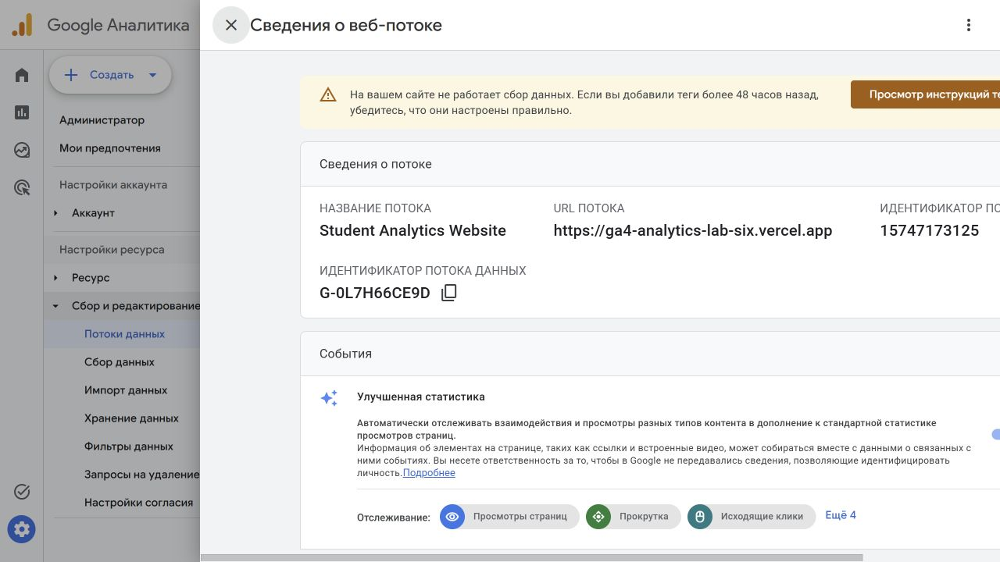
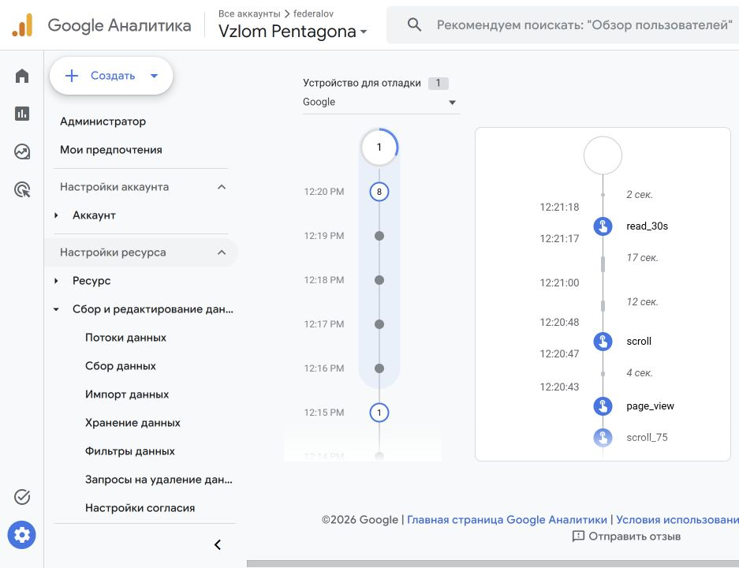

# Скриншоты задания 3

Формат PNG. Имена файлов:

| Файл | Что на кадре |
|---|---|
| `01-tag-detected.png` | проверка тега: «На вашем сайте обнаружен тег Google» |
| `02-tag-in-code.png` | код тега на странице сайта, виден Measurement ID |
| `03-realtime.png` | отчёт Realtime с событием `page_view` |
| `04-source.png` | источник перехода в GA4 после перехода по ссылке с UTM |
| `05-reports.png` | страница «Отчёты» со статистикой за период |

На кадрах должны быть видны адрес своего сайта и свой Measurement ID.

Этот файл удалять не нужно.

## Кадры из своего проекта

Источник — [4youmans/ga4-analytics-lab](https://github.com/4youmans/ga4-analytics-lab).

*Веб-поток GA4 для учебного сайта.*

*События учебного сайта в DebugView.*
