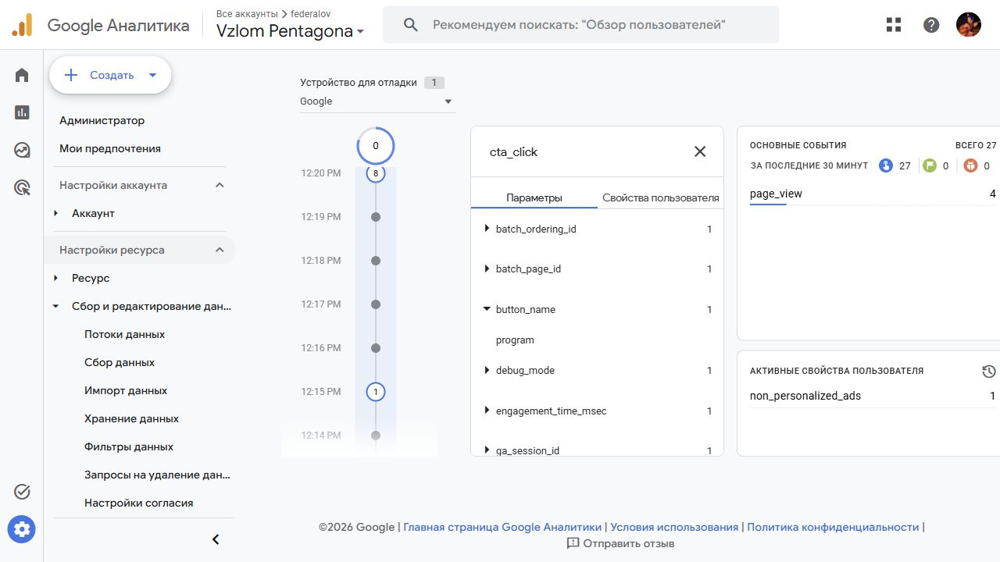
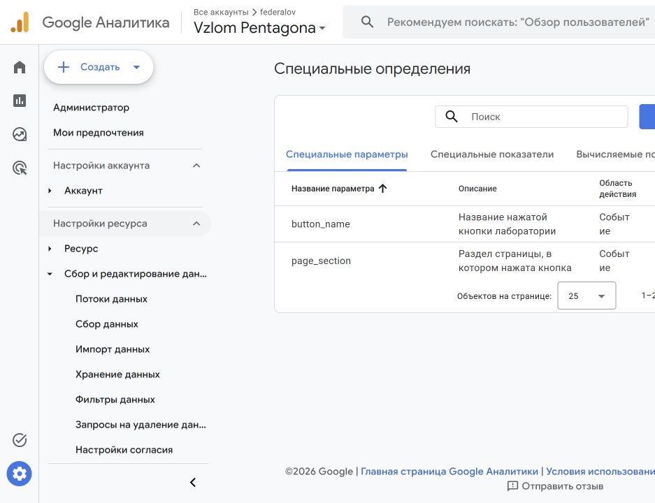
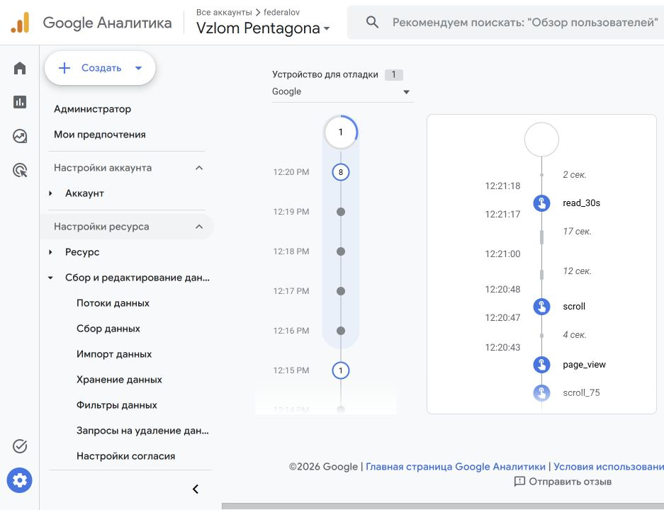
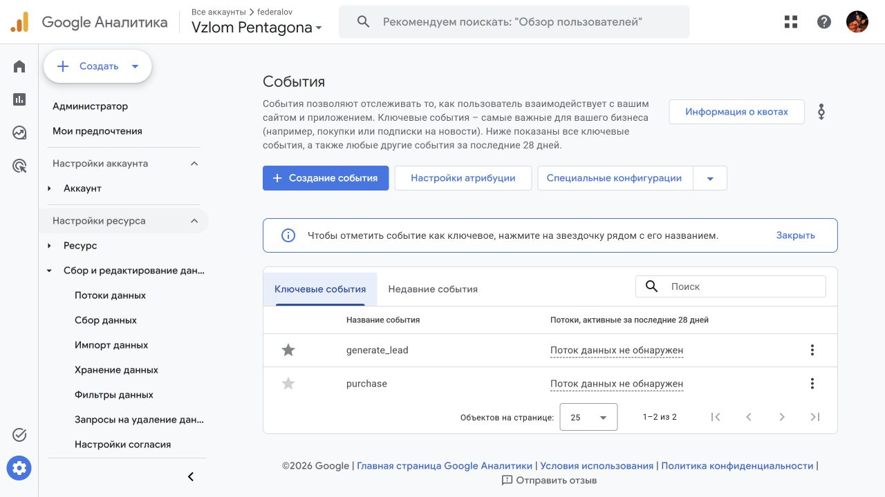
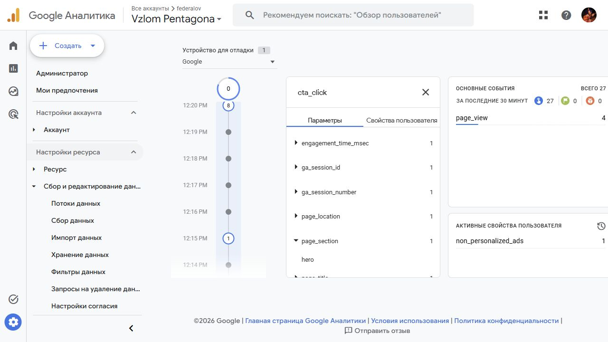
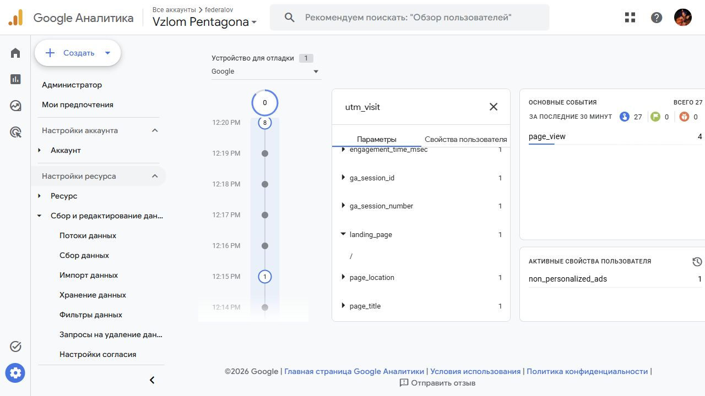
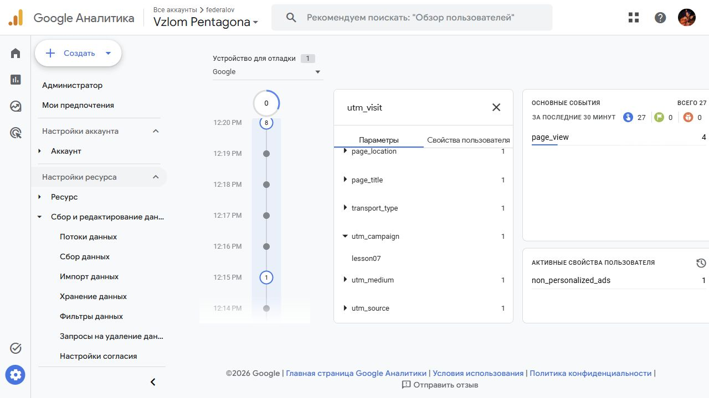
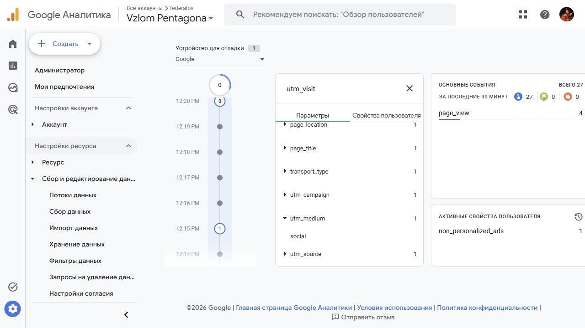
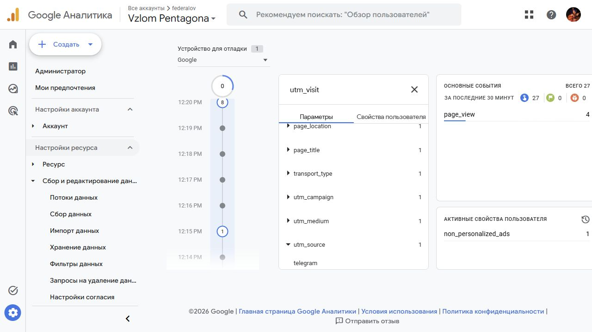

# Скриншоты задания 4

Формат PNG. Имена файлов:

| Файл | Что на кадре |
|---|---|
| `01-code.png` | файл `js/metrics.js` в проекте и строка подключения в HTML |
| `02-debugview.png` | лента DebugView с новыми событиями |
| `03-utm-params.png` | раскрытое `utm_visit` со значениями `utm_source`, `utm_medium`, `utm_campaign` |
| `04-realtime.png` | событие в Realtime или в отчёте по событиям за период |

На кадрах должны быть видны адрес своего сайта и свой Measurement ID.

Этот файл удалять не нужно.

## Кадры из своего проекта

Источник — [4youmans/ga4-analytics-lab](https://github.com/4youmans/ga4-analytics-lab).

*Параметр button_name.*

*Список специальных параметров в GA4.*

*Лента событий в DebugView.*

*Ключевое событие в GA4.*

*Параметр page_section.*

*UTM-параметры события.*

*Значение utm_campaign.*

*Значение utm_medium.*

*Значение utm_source.*
